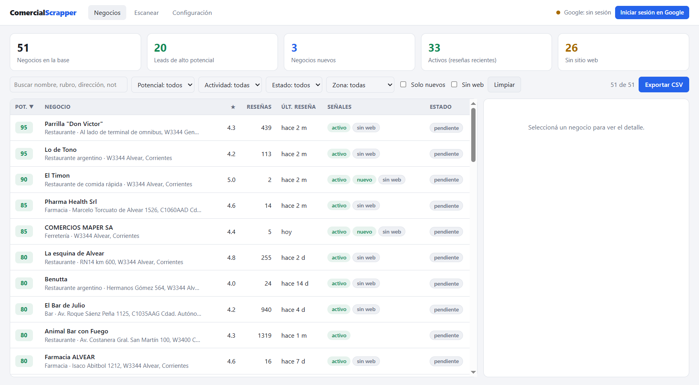
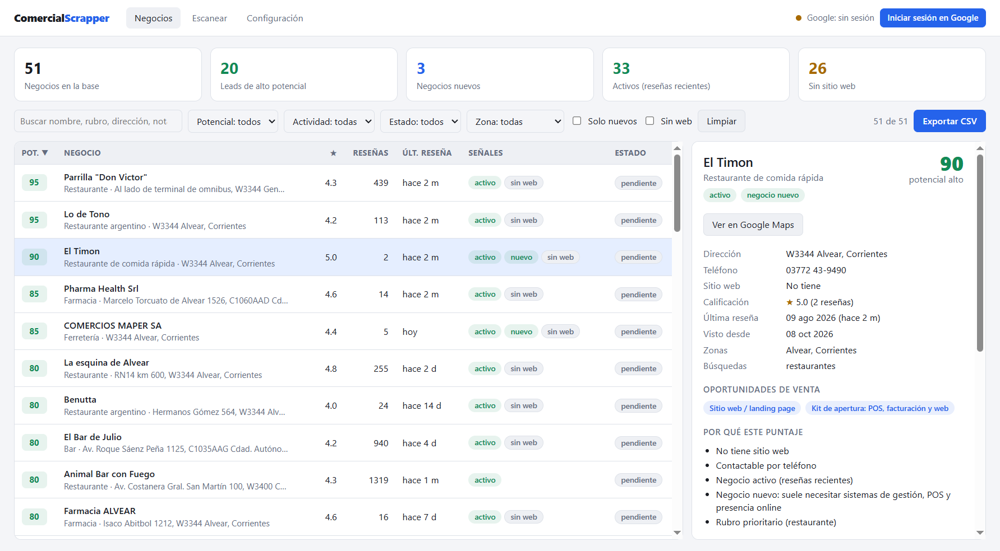
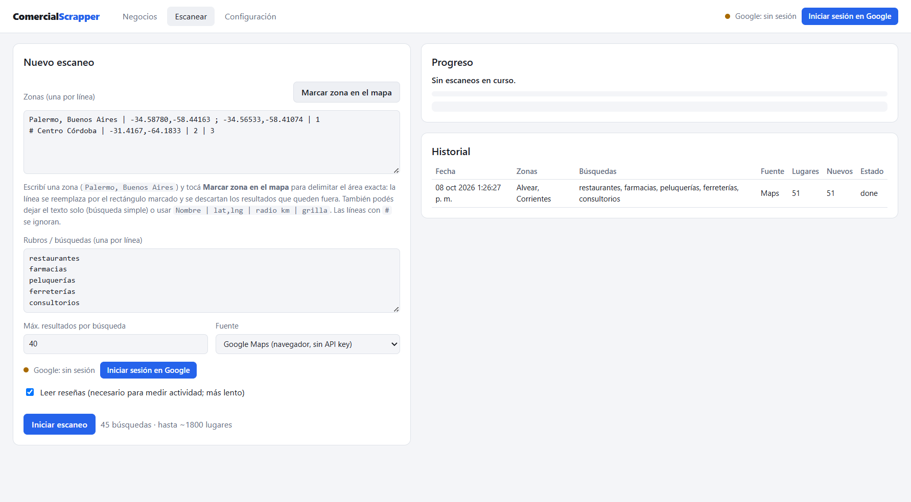
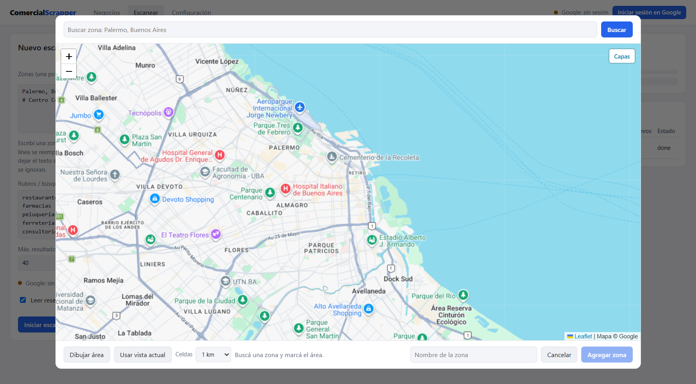

# Comercial Scrapper

Aplicación de escritorio (Electron + TypeScript + Web Components) que **releva comercios por zona en Google Maps y los
clasifica automáticamente como prospectos** para la venta de soluciones informáticas. Convierte un trabajo manual
(recorrer mapas, mirar reseñas, anotar en una planilla) en un listado priorizado y exportable.

## Qué resuelve

- **Relevamiento por zona**: dibujás un área en el mapa, se divide en celdas y se busca por celda y rubro, descartando
  lo que cae fuera del área.
- **Clasificación con reglas explicables**: cada negocio recibe un puntaje de 0 a 100 con los motivos y las
  oportunidades de venta, no una caja negra.
- **Seguimiento en el tiempo**: al re-escanear la misma zona detecta negocios nuevos y reseñas nuevas contra el
  historial.
- **Salida lista para usar**: filtros, estado comercial, notas y exportación a CSV que abre directo en Excel.

## Capturas

| Negocios priorizados | Detalle con motivos del puntaje |
| --- | --- |
|  |  |

| Nuevo escaneo | Marcar la zona en el mapa |
| --- | --- |
|  |  |

## Cómo clasifica

Para cada negocio determina:

- **Si es nuevo**: Google lo marca como recién inaugurado, tiene pocas reseñas, su primera reseña es reciente, o
  apareció en un re-escaneo de una zona que ya se había recorrido.
- **Si está activo**: fecha de la última reseña (ordenando por "más recientes") y reseñas nuevas entre escaneos.
- **Potencial como cliente (0–100)**: falta de sitio web (o una "web" que es Instagram/Facebook/Wix), rubro prioritario,
  actividad, tamaño PyME, negocio nuevo y dolores mencionados en reseñas (turnos, pedidos, pagos con tarjeta,
  facturación, demoras, no atienden el teléfono, stock…). Cada puntaje muestra sus motivos y las oportunidades de venta.

## Alcance y adaptación a otros relevamientos

Hoy la herramienta releva **comercios y sus reseñas** (no propiedades ni precios). La arquitectura separa la fuente
de datos (`scraper/`), las reglas (`classifier.ts`) y el escaneo por zonas y celdas (`scanner.ts`, `grid.ts`), de modo
que el mismo esquema puede apuntarse a otras fuentes, por ejemplo portales de avisos para relevar precios por zona.
Esa adaptación **no está implementada** en este repositorio.

## Pendiente de implementar

- **Resolución de captcha (anticaptcha)**: hoy, ante un captcha de Google el escaneo se detiene y se conserva lo ya
  analizado. Falta automatizar ese paso para poder correr relevamientos largos sin intervención.

## Uso

```bash
npm install
npm start
```

1. **Escanear**: cargá las zonas (una por línea) y los rubros.
   - Escribí `Palermo, Buenos Aires` y tocá **Marcar zona en el mapa**: el mapa se centra en la zona, marcás el
     área arrastrando un rectángulo (o usás la vista actual) y elegís el tamaño de celda. La línea se reemplaza por
     el rectángulo (`Palermo, Buenos Aires | -34.58780,-58.44163 ; -34.56533,-58.41074 | 1`). El área se divide en
     celdas y se hace una búsqueda por celda y rubro; los resultados que Google devuelve fuera del rectángulo se
     descartan.
   - También sirve el texto solo (búsqueda simple, sin filtro de área) o `Nombre | lat,lng | radio km | grilla`.
   - Mientras escanea, **■ Detener escaneo** (arriba a la derecha) corta en el momento; lo ya analizado queda guardado.
2. **Negocios**: filtrá por potencial, actividad, zona, nuevos o sin web; abrí el detalle para ver motivos, reseñas e
   historial; registrá el estado comercial y notas; exportá a CSV (separado por `;`, abre directo en Excel).
3. **Re-escaneá periódicamente** las mismas zonas: así se detectan negocios que aparecen por primera vez y reseñas
   nuevas desde el escaneo anterior.

## Fuentes de datos

| Fuente | Pros | Contras |
| --- | --- | --- |
| **Google Maps (navegador)** | Sin API key, hasta 20 reseñas por lugar ordenadas por fecha | Más lento (~10 s por lugar con reseñas), depende del HTML de Google y puede chocar con sus términos de uso |
| **Google Places API** | Oficial y estable | Requiere API key con facturación, máx. 5 reseñas por lugar y 60 resultados por búsqueda |

Con la fuente navegador, si Google muestra la pantalla de cookies se abre la ventana para que elijas una opción.

**Sesión de Google:** sin sesión, Google Maps muestra una vista limitada (unos 8 resultados por búsqueda, pocas reseñas
y a veces sin orden por fecha); el progreso del escaneo lo avisa. Usá **Iniciar sesión en Google** (arriba a la
derecha, también en Escanear y Configuración); la ventana se cierra sola al terminar. La sesión queda aislada en la
app y se puede cerrar desde el mismo botón. Conviene usar una cuenta secundaria.

El mapa para marcar zonas usa teselas de Google Maps (o OpenStreetMap desde "Capas") y la búsqueda de lugares de
Nominatim/OpenStreetMap, que devuelve el contorno del barrio; si no encuentra la zona, la busca en Google Maps.

Usalo con volumen moderado y respetando la pausa entre páginas: ante un captcha el escaneo se detiene.

## Desarrollo

```bash
npm run typecheck   # tsc --noEmit
npm test            # tests de la lógica (clasificador, fechas, zonas, grilla, CSV)
npm run watch       # recompila con esbuild ante cambios
```

```
src/
  shared/types.ts            Tipos compartidos y API expuesta al renderer
  main/
    main.ts                  Ventana principal e IPC
    scanner.ts               Orquestación: zonas × rubros → celdas → resultados → detalle
    classifier.ts            Reglas de negocio nuevo / actividad / potencial
    store.ts                 Base JSON en la carpeta de datos del usuario (historial por escaneo)
    geocode.ts               Búsqueda de zonas por nombre (Nominatim, con Google Maps de respaldo)
    dates.ts, csv.ts
    scraper/
      maps-browser.ts        Proveedor Google Maps en una ventana oculta de Electron
      page-scripts.ts        Código que corre dentro de Google Maps (selectores)
      places-api.ts          Proveedor Google Places API (New)
  shared/grid.ts             Celdas de búsqueda por zona y filtro de pertenencia
  preload/preload.ts         Puente seguro (contextIsolation) hacia window.api
  renderer/                  Web Components nativos con Shadow DOM
    components/              app-shell, stats-bar, business-filters, business-table,
                             business-detail, scan-panel, settings-panel,
                             zone-map-dialog (Leaflet), session-badge
```

Los datos se guardan en `%APPDATA%\comercial-scrapper\data.json`.

Si Google cambia su HTML y dejan de aparecer datos, los selectores a ajustar están en
`src/main/scraper/page-scripts.ts`. Para ver qué hace el scraper, activá "Mostrar la ventana de Google Maps" en
Configuración.
